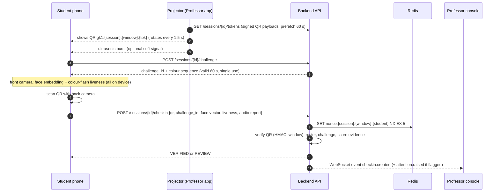
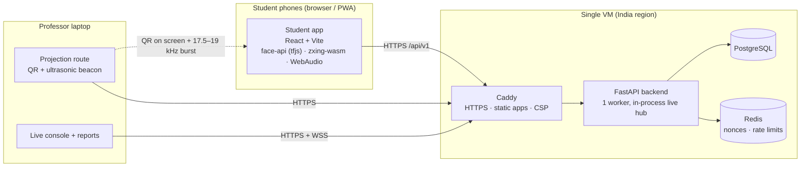

<div align="center">

# GateKeeper

**Zero-hardware, hard-to-cheat classroom attendance.**
A rotating QR on the projector, a face check with a liveness flash on the student's own phone, and a soft ultrasonic "you are in the room" signal. The professor stays in charge: nothing is ever marked absent automatically.

`v1.0.0-rc1` · Python 3.12 · FastAPI · React 18 + Vite + TypeScript · PostgreSQL / Redis · Proprietary (private)

[Quick start](#quick-start) · [How it works](#how-it-works) · [Architecture](#architecture) · [Install](#installation) · [Configuration](#configuration-reference) · [API](#api-overview) · [Deploy](#deployment) · [Field trials](#field-trials) · [FAQ](#faq)

</div>

---

## Table of contents

1. [What GateKeeper is](#what-gatekeeper-is)
2. [Status: what is proven and what is not](#status-what-is-proven-and-what-is-not)
3. [Features](#features)
4. [How it works](#how-it-works)
5. [Architecture](#architecture)
6. [Repository layout](#repository-layout)
7. [Quick start](#quick-start)
8. [Installation](#installation)
9. [Running a class (end to end)](#running-a-class-end-to-end)
10. [Configuration reference](#configuration-reference)
11. [API overview](#api-overview)
12. [Data model](#data-model)
13. [Security and anti-cheat model](#security-and-anti-cheat-model)
14. [Privacy and data retention](#privacy-and-data-retention)
15. [Testing](#testing)
16. [Deployment](#deployment)
17. [Operations](#operations)
18. [Field trials](#field-trials)
19. [Troubleshooting](#troubleshooting)
20. [FAQ](#faq)
21. [Documentation index](#documentation-index)
22. [Contributing, security reports, license](#contributing-security-reports-license)

---

## What GateKeeper is

Attendance in a lecture hall is slow when done by roll call and easy to fake when done by a shared QR or a paper sheet. GateKeeper makes faking it harder than turning up, without any hardware in the room beyond the projector the professor already has.

| Goal | How |
|---|---|
| Hard to cheat | Rotating signed QR (new code every 1.5 s) + on-device face match against an enrolled reference + colour-flash liveness + a near-ultrasonic beacon + professor spot-checks |
| Low latency | Check-in is one request; QR is verified with a single HMAC; target p95 under 2 s end to end |
| Minimal manual work | Roster CSV upload, one-tap enrollment confirmation, an Attention Panel that shows only the few students who need a human look |
| Fair to students | Nothing auto-marks anyone absent; every absence can be disputed; the student dashboard says exactly how many classes they can still miss |
| Private | Face embeddings are computed on the phone; the server keeps a 128-number vector and one encrypted reference photo per student, deleted at term end or on request |

Three interfaces, nothing else:

| Interface | Who / device | What |
|---|---|---|
| **Student app** (`student-pwa/`) | Student, phone browser, installable PWA | Enroll, check in, see attendance and the "how many can I skip" advice, dispute, delete face data |
| **Professor app** (`prof-console/`) | Professor, laptop browser | Courses and roster, confirm enrollments, run a session (projector screen + private live console), reports, disputes |
| **Backend** (`backend/`) | VM | FastAPI service, PostgreSQL, Redis, ops scripts. No admin UI in v1 |

## Status: what is proven and what is not

This is a **release candidate**. Be clear-eyed about it:

| Area | State |
|---|---|
| Backend logic, API, auth, trust scoring, calculator, retention | Implemented; 164 automated tests pass (SQLite, fake Redis) |
| Web apps | Build clean; exercised through AGY's acceptance runs |
| QR scanning on real phones, in real rooms | **Not yet field-tested** |
| Face model accuracy, thresholds (`0.55`, `0.45`, liveness `0.3`) | **Chosen from literature; need calibration on real students** |
| Ultrasonic audio on real phones and rooms | Codec verified in simulation only; **real-device trials pending** (audio is a soft signal for exactly this reason) |
| PostgreSQL | Code is portable but the suite has only run on SQLite |
| Deploy files (`deploy/`) | Written, never run (no Docker on the build machine) |

Known gaps and deferred ideas live in [`docs/KNOWN_ISSUES.md`](docs/KNOWN_ISSUES.md) and [`docs/PARKING_LOT.md`](docs/PARKING_LOT.md). Nothing in this README should be read as a measured accuracy claim: [`docs/FIELD_PROTOCOL.md`](docs/FIELD_PROTOCOL.md) is how the real numbers get produced.

## Features

**Student app**
- Login, one-time consent + enrollment (reference selfie → on-device 128-d embedding → professor confirms against the ID card)
- Check-in: face + colour-flash liveness (front camera) → scan the projected QR (back camera); ultrasonic beacon is listened for in the background
- Result in plain words: *Checked in*, or *Your professor may confirm in person*
- Attendance dashboard per course: percentage, Safe / Borderline / Below, "you can miss N more classes" or "attend the next N in a row"
- History with a **I was there** dispute button on absences; dispute outcomes
- Privacy tab: what is stored, delete my face data

**Professor app**
- Courses (required %, planned total, excused-counts toggle), roster CSV import (creates student accounts with one-time passwords)
- Enrollment confirmation with the reference photo
- **Projection** route for the projector: QR only, no student data; optional ultrasonic beacon with volume control
- **Live console** over WebSocket: counts, check-in rate, p50/p95 latency, Attention Panel (flagged + overdue students with photo, reason, *Seen / Not here / Unsure*), random audit samples, manual add with reason, pause / resume / close
- After class: summary and CSV export (formula-injection safe), course report, disputes inbox (Accept / Reject with a note)

## How it works

### One check-in, step by step



Order matters: the face step runs **first** and the QR is scanned **last**, so the QR is still fresh when it is submitted.

### The QR token

`gk1:{session_id}:{window}:{tok}` where `window = floor(server_ms / step_ms)` and `tok` is the first 16 base32 characters of `HMAC_SHA256(session_secret, "{session_id}|{window}")`. The secret is random per session and never leaves the server; the professor client receives pre-signed payloads. The current and previous window are accepted. Spec and test vectors: [`shared/TOKEN_SPEC.md`](shared/TOKEN_SPEC.md), [`shared/token_vectors.json`](shared/token_vectors.json).

The whole room scans the **same** code, so the replay guard is per student: `nonce:{session}:{window}:{student}` set with `NX EX 5`. A photographed QR is useless a few seconds later and for any other session.

### The trust score

Every check-in is scored from independent signals:

| Signal | Weight | Meaning |
|---|---|---|
| Valid, fresh QR | 0.5 | Hard gate: no valid QR, no check-in |
| Face matches the enrolled reference | 0.3 | Euclidean distance between 128-d vectors ≤ `0.55` |
| Liveness (colour flash) | 0.2 | Face chroma shifts toward the colour shown on screen in ≥ 3 of 4 steps |
| Audio beacon | soft | Heard = no change; not heard = −0.1 and flag `AUDIO_UNAVAILABLE`; wrong code = `AUDIO_MISMATCH` |

`VERIFIED` needs a score ≥ 0.8 **and** no review flag. Anything else that passed the hard gates becomes `REVIEW` with the reasons attached: `FACE_MISMATCH`, `FACE_COLLISION` (two accounts in one session look like the same person; both go to review), `LIVENESS_FAIL`, `FACE_MISSING`, `LIVENESS_MISSING`, `AUDIO_MISMATCH`. The scorer never produces `REJECTED`; a human decides.

### The professor's safety net

At close, every rostered student gets an attendance record: checked in → present; unresolved `REVIEW` → present with the note `unreviewed: <flags>` (benefit of the doubt, listed for later); nobody seen → absent (disputable). The Attention Panel ranks flagged students first, then those who are overdue (not checked in 3 minutes after start, ranked by their past absence rate), plus 2 random `VERIFIED` students as an audit sample, which is how the false-accept rate is measured in real classes instead of guessed.

### The attendance calculator

Exact integer/fraction arithmetic ([`backend/app/calculator.py`](backend/app/calculator.py)); `A` attended, `T` conducted (the student's own closed-session records), `r` required fraction:

- skip now: `floor(A/r) − T` (never below 0)
- with a planned total `S`: `can_skip_until_end = (S − T) − max(0, ceil(r·S) − A)`
- below the line: `need_in_a_row = ceil((r·T − A)/(1 − r))`
- status: Safe (can skip ≥ 2), Borderline (0–1), Below

Worked examples: `27/34 @ 75%` → 79.4 %, skip 2. `20/30 @ 75%` → 66.7 %, attend 10 in a row.

## Architecture



### Backend modules (`backend/app/`)

| Module | Responsibility |
|---|---|
| `main.py` | App factory, request-id + security-header + JSON-log middleware, uniform error envelope, lifespan |
| `config.py` | All settings from environment; refuses unsafe production config |
| `db.py`, `models.py` | SQLAlchemy 2 engine (SQLite WAL in dev) and tables |
| `security.py`, `deps.py` | Argon2 passwords, JWT access/refresh, role guards |
| `tokens.py` | QR payload signing/verification, audio code derivation (pure) |
| `nonce.py`, `ratelimit.py` | Redis (prod) or in-process (dev) per-student replay guard and rate limits |
| `trust.py` | Pure scoring: liveness, face distance, collisions, final status |
| `attention.py` | Ranking of flagged / overdue / audit-sample students |
| `events.py` | In-process pub/sub hub with sequence numbers and replay for WebSocket reconnects |
| `calculator.py` | The attendance maths (pure, exact) |
| `retention.py` | Daily and term-end data deletion |
| `storage.py` | Photo encryption (Fernet), signed photo URLs, audit log helper |
| `routers/core.py` | Login, refresh, `/me`, `/time`, health |
| `routers/courses.py` | Courses, roster import, enrollment confirm/reject, photo access |
| `routers/enrollment.py` | Student consent, enroll, status, delete face data |
| `routers/sessions.py` | Session lifecycle, token batches |
| `routers/checkin.py` | Active sessions, challenge, **check-in**, audio plan, trial audio log |
| `routers/live.py` | Close, attendance, attention, spot-checks, manual, export, WebSocket |
| `routers/dashboard.py` | Student dashboard, disputes; professor report and dispute decisions |

### Frontend structure

| Path | Contents |
|---|---|
| `student-pwa/src/` | `Home` (tabs), `Scan` (face → QR flow), `faces.ts` (model + liveness), `scanner.ts` (BarcodeDetector or zxing-wasm), `audio.ts` (AudioWorklet listener), `Dashboard.tsx` |
| `prof-console/src/` | `App` (courses, roster, enrollments), `Projection` (QR render + beacon), `Session` (live console), `Reports` (report + disputes) |
| `shared/` | `api.ts` (fetch wrapper with refresh), `audiocodec.ts` (burst encoder/decoder used by both sides), token spec + vectors |

### Key design decisions

Full log with reasons: [`docs/DECISIONS.md`](docs/DECISIONS.md). The ones that shape everything:

- **Human final say.** The system flags; the professor decides. No automatic absences, no automatic rejections.
- **Hard gates vs soft signals.** Only the QR and the roster are hard gates. Face, liveness and audio change confidence, never availability, because every one of them fails on some real phone.
- **Embeddings on the device.** No face image goes through the check-in path; only 128 numbers do.
- **One process for the live feed.** A single backend worker keeps the live hub simple and correct. Scale the VM, not the worker count (a Redis pub/sub hub is parked).
- **Boring stack, no new moving parts.** One VM, one Postgres, one Redis, Caddy for HTTPS.

## Repository layout

```
.
├── backend/                 FastAPI service
│   ├── app/                 application code (see module table above)
│   ├── scripts/             seed.py (dev), create_user.py, retention.py, export_openapi.py
│   └── tests/               pytest suites (builder checks + AGY acceptance suites P1–P9)
├── student-pwa/             Student app (React, Vite, TypeScript)
│   └── public/models/       self-hosted face-api weights (6.4 MB, lazy-loaded)
├── prof-console/            Professor app (React, Vite, TypeScript)
├── shared/                  Code and specs used by both apps and the backend tests
├── deploy/                  docker-compose, Caddyfile, Dockerfiles, backup script, .env.example
├── bench/                   Offline audio simulation and early device spikes
├── docs/
│   ├── ARCHITECTURE.md      deeper internals
│   ├── DEPLOY.md            production runbook
│   ├── FIELD_PROTOCOL.md    how to run classroom trials and measure the real numbers
│   ├── KNOWN_ISSUES.md      what is not done / not proven
│   ├── DECISIONS.md         decision log
│   ├── PARKING_LOT.md       deferred ideas
│   ├── V1_SCOPE_AND_PHASES.md  the v1 scope fence and API
│   ├── openapi.json         generated API schema
│   ├── acceptance/          per-phase acceptance cases (P1–P9)
│   ├── design/              original build plan and product spec
│   └── research/            audio reliability research and notes
├── CHANGELOG.md · CONTRIBUTING.md · SECURITY.md · LICENSE · Makefile
```

## Quick start

Requirements: Python 3.12 with [`uv`](https://docs.astral.sh/uv/), Node 20+ and npm. No Docker, Redis or Postgres needed for development.

```bash
git clone https://github.com/PrinceJha-Qua/Attendance_software.git && cd Attendance_software
make setup        # installs backend + both apps
make seed         # demo data: 1 professor, 1 course, 30 students
make dev          # API :8000, student app :5173, professor app :5174
```

Demo logins (dev only; password `gatekeeper-dev`):

| Role | Identifier |
|---|---|
| Professor | `prof@example.edu` |
| Student | `student01@example.edu` … `student30@example.edu` (roll numbers `R001` … `R030`) |

Open <http://localhost:5174> as the professor and <http://localhost:5173> as a student. Phones need HTTPS for camera and microphone; see [phone testing](#testing-on-a-real-phone).

## Installation

### Prerequisites

| Tool | Version | Notes |
|---|---|---|
| Python | 3.12 | managed by `uv` via `backend/.python-version` |
| uv | recent | `curl -LsSf https://astral.sh/uv/install.sh \| sh` |
| Node.js | 20 or 22 | with npm |
| Docker + compose | for production only | not needed locally |

### Backend

```bash
cd backend
uv sync                          # creates .venv, installs from uv.lock
uv run python scripts/seed.py    # creates gatekeeper.db with demo data (dev only)
uv run uvicorn app.main:app --reload --port 8000
```

Health: <http://localhost:8000/api/v1/healthz>. Interactive API docs (dev only): <http://localhost:8000/docs>.

Defaults in development: SQLite file `backend/gatekeeper.db` (WAL), in-process nonce store, a built-in dev secret. **Adding a column to a model has no migration**: delete `gatekeeper.db` and re-seed.

### Student app

```bash
cd student-pwa
npm ci
npm run dev        # http://localhost:5173, proxies /api to :8000
npm run build      # type-check + production bundle in dist/
```

### Professor app

```bash
cd prof-console
npm ci
npm run dev        # http://localhost:5174, proxies /api and WebSocket to :8000
npm run build
```

### Testing on a real phone

Browsers only expose the camera and microphone on HTTPS (or `localhost`). Put an HTTPS tunnel in front of the student dev server and open that URL on the phone:

```bash
npx cloudflared tunnel --url http://localhost:5173
```

The student app proxies `/api` itself, so one tunnel is enough. For the projector, open the professor app in a normal browser tab, start a session, click **Projection**, press **F** for fullscreen.

## Running a class (end to end)

1. **Professor, once per course**: create the course (required %, planned total), upload the roster CSV (`roll_no,name,email`). The response shows each new student's one-time password **once**; hand them out.
2. **Students, once**: log in, accept the consent text, take the reference selfie. The professor opens *Enrollments*, compares the photo with the student's ID card in person, and taps *Confirm*.
3. **Each class**: professor creates a session (tick the ultrasonic beacon if the room should use it), clicks *Start*, opens *Projection* on the projector, and keeps *Console* on the laptop.
4. **Students** open the app, tap the live class, follow the face prompt (look at the screen while it flashes colours), then point the back camera at the QR.
5. **Professor** watches the counts; looks only at the Attention Panel; marks *Seen / Not here / Unsure*; adds anyone legitimate who could not check in with a reason.
6. **Close** the session: records are written, the CSV is available.
7. **Students** see the updated percentage and advice; absences they disagree with go to the dispute inbox.

Roster CSV format and rules are enforced server-side (max 1000 rows, 1 MB).

## Configuration reference

All settings are environment variables read in [`backend/app/config.py`](backend/app/config.py). Production adds hard guards: the server refuses to start if a required one is missing or unsafe.

| Variable | Default | Production | Purpose |
|---|---|---|---|
| `GK_ENV` | `dev` | `prod` | Turns on the guards below, HSTS, JSON logs; disables `/docs` |
| `GK_SECRET_KEY` | dev placeholder | **required** | Signs JWTs, QR/audio keys derivation, photo URLs |
| `GK_PHOTO_KEY` | derived from secret | **required** | Fernet key for reference photos at rest |
| `GK_DATABASE_URL` | `sqlite:///./gatekeeper.db` | **Postgres required** | `postgresql://user:pw@host/db` is rewritten to the psycopg 3 driver |
| `GK_REDIS_URL` | unset (in-process) | **required** | Nonces and rate-limit counters |
| `GK_FACE_MODE` | `required` | must be `required` | `off` restores QR-only behaviour (dev regression runs) |
| `GK_RATE_LIMIT` | `on` | must be `on` | |
| `GK_TRIAL_MODE` | `0` | `0` except during audio trials | `1` stores phone audio telemetry |
| `GK_CORS_ORIGINS` | empty | empty (same origin) | Comma-separated origins if apps are served from elsewhere |
| `GK_LOG_JSON` | `1` in prod | | One JSON line per request |
| `GK_ACCESS_TTL_S` / `GK_REFRESH_TTL_S` | 3600 / 14 days | | Token lifetimes |
| `GK_RETAIN_VECTOR_DAYS` | 30 | | Age at which check-in face vectors are cleared |
| `GK_RETAIN_TELEMETRY_DAYS` | 90 | | Age at which audio telemetry is deleted |

Tunable constants that are deliberately **not** environment variables (they change only from field data, then in code): face distance `0.55`, collision `0.45`, liveness cosine `0.3` and 3-of-4 steps, verified threshold `0.8`, weights `0.5 / 0.3 / 0.2`, QR step 1.5 s, audio band 17.5–19 kHz and burst age 8 s, challenge TTL 60 s, attention grace 180 s, audit sample 2.

## API overview

Base path `/api/v1`, JSON, `Authorization: Bearer <access token>`. Errors are always `{"error": {"code", "message", "request_id"}}`. The full machine-readable contract is [`docs/openapi.json`](docs/openapi.json) (regenerate with `make openapi`).

| Group | Endpoints |
|---|---|
| Auth | `POST /auth/login`, `/auth/refresh`, `/auth/logout` · `GET /me`, `/time` |
| Student: privacy | `POST /students/me/consent`, `/students/me/enroll` · `GET /students/me/enrollment` · `DELETE /students/me/face-data` |
| Student: check-in | `GET /sessions/active` · `POST /sessions/{id}/challenge`, `/sessions/{id}/checkin` · `GET /sessions/{id}/checkin/me`, `/sessions/{id}/audio-plan` · `POST /trial/audio-log` |
| Student: dashboard | `GET /students/me/courses`, `/students/me/courses/{id}/attendance`, `/students/me/disputes` · `POST /students/me/attendance/{record}/dispute` |
| Professor: setup | `GET/POST /courses` · `PATCH /courses/{id}` · `POST /courses/{id}/roster/import` · `GET /courses/{id}/roster` · enrollments `pending`, `confirm`, `reject` · `GET /students/{id}/photo` (signed, 5 min, audited) |
| Professor: session | `POST /sessions` · `GET /sessions/{id}` · `start`, `pause`, `resume`, `close` · `GET /sessions/{id}/tokens` |
| Professor: live | `GET /sessions/{id}/attendance`, `/attention`, `/spotcheck/suggestions`, `/export` · `POST /sessions/{id}/spotcheck/{student}`, `/attendance/{student}/resolve`, `/attendance/manual` · **WS** `/ws/sessions/{id}?token=&since_seq=` |
| Professor: reports | `GET /courses/{id}/report`, `/courses/{id}/disputes` · `POST /disputes/{id}/decide` |
| Ops | `GET /healthz`, `/readyz` |

Check-in request (abridged):

```json
POST /api/v1/sessions/{id}/checkin
{
  "qr": "gk1:…",
  "challenge_id": "…",
  "face": { "vector": [/* 128 floats */], "model": "faceapi-128-v1" },
  "liveness": { /* colour-flash samples */ },
  "audio": { "status": "heard", "…": "…" },
  "scanned_at_client_ms": 1730000000000,
  "device": { "decoder": "BarcodeDetector", "w": 1280, "h": 720 }
}
→ 200 { "status": "VERIFIED" | "REVIEW", "…": "…" }
```

Repeating a check-in after a lost response returns the original result (idempotent). Live feed events: `hello`, `checkin.created`, `checkin.updated`, `attention.raised`, `attention.cleared`, `session.state`, `stats.tick`; reconnect with `since_seq` to replay what was missed or get `resync: true`.

## Data model

| Table | Purpose |
|---|---|
| `users` | students and professors (email, optional roll number, role, Argon2 hash) |
| `courses`, `roster` | a professor's courses; students on each |
| `consents`, `face_templates` | consent record; one 128-d vector + encrypted reference photo per student, status `pending/confirmed/rejected` |
| `sessions` | one class meeting: status, step, audio mode, per-session secret |
| `challenges` | one-time liveness challenges |
| `checkins` | the evidence behind each check-in: status, score, flags, numeric evidence, device, latency |
| `attendance_records` | the final per-student outcome written at close (`present/absent/excused`, source, note) |
| `spotchecks`, `disputes` | professor verification results; student disputes and decisions |
| `audit_log` | who did what: logins, photo views, enrollment decisions, session lifecycle, resolutions, exports, retention |
| `audio_logs` | field-trial telemetry (trial mode only) |

Tables are created from the models at startup; there are no migrations yet (see [known issues](docs/KNOWN_ISSUES.md)).

## Security and anti-cheat model

Threat model for v1: the **casual cheater** (asking a friend to scan for them, photographing the QR and sending it, holding two phones). A determined attacker with a rooted phone, a virtual camera and a live video relay is a different threat that no software-only web app fully defeats; v1 raises the cost and makes the pattern visible rather than claiming it is impossible.

| Attack | Defence |
|---|---|
| Send a photo of the QR to a friend outside | QR rotates every 1.5 s, only the current and previous window verify |
| Friend scans with your phone | Face must match *your* enrolled reference; liveness flash |
| One person checks in two accounts on two phones | Face collision detection puts both in review |
| Replaying a captured request | Per-student nonce, single-use challenge, session-bound QR |
| Photo / screen replay of a face | Colour-flash liveness requires the face to react to colours chosen by the server |
| Live relay of the QR from the room | Audio beacon (soft), spot-checks, audit sample, anomaly flags; not eliminated |
| Credential guessing | Argon2, per-account login lockout, rate limits, audit log |
| Data theft | Photos encrypted at rest, signed 5-minute photo URLs for the owning professor only, retention jobs, HTTPS + HSTS + CSP |

Production hardening: strict CSP and security headers on API and static hosts, no `/docs`, uniform error envelope that never leaks internals, request ids on every response, JSON logs without query strings or bodies, CSV export neutralises spreadsheet formulas, start-up refuses unsafe config.

Report vulnerabilities as described in [`SECURITY.md`](SECURITY.md).

## Privacy and data retention

- What leaves the phone during check-in: a 128-number face vector, colour-response numbers, and an audio report. No photo.
- What the server keeps per student: one vector and one encrypted reference photo (taken at enrollment), plus attendance records.
- Students can delete their face data at any time (Privacy tab); they re-enroll to check in again.
- Nightly job clears check-in face vectors after 30 days and telemetry after 90.
- End of term: `scripts/retention.py --term-end <course_id>` deletes templates and photos for the course's roster. Attendance records and the audit log are the academic record and stay.
- **Open item for the institution:** a named data owner and the DPDP-Act sign-off (consent text, lawful purpose, grievance contact). This is a human process, not code; see [`docs/KNOWN_ISSUES.md`](docs/KNOWN_ISSUES.md).

## Testing

```bash
make test            # backend suite
make build           # type-check and build both apps
make audio-sim       # offline simulation of the ultrasonic codec
```

| Suite | Where | Notes |
|---|---|---|
| Builder checks | `backend/tests/test_calculator.py`, `test_dashboard.py`, `test_face_layer.py`, `test_live_console.py`, `test_hardening.py`, `test_tokens.py` | Fast, own fixtures |
| Acceptance suites | `backend/tests/test_acceptance_p1.py … p9.py` | Written and run by the independent tester against `docs/acceptance/P*.md` |
| Audio codec | `bench/audio_sim.ts` | Encode → simulated room (noise, reverb, clock drift, 44.1/48 kHz) → decode; results in `docs/audio_sim_results.txt` |
| Real devices | `docs/FIELD_PROTOCOL.md` | The part no simulator can replace |

Tests use SQLite and an in-memory Redis stand-in. Run the suite against PostgreSQL before relying on it in production:
`GK_DATABASE_URL=postgresql://… make test`.

## Deployment

Target: one small VM in an India region running the stack in [`deploy/`](deploy/): Caddy (automatic HTTPS, serves both apps, security headers), the backend (one worker), PostgreSQL 16, Redis 7.

```bash
cd deploy
cp .env.example .env && chmod 600 .env     # fill secrets, set the two hostnames
docker compose up -d --build
docker compose exec backend python scripts/create_user.py professor you@college.edu "Dr Name"
```

Two DNS names are needed (student host and professor host). The step-by-step runbook, post-deploy checks, backups and restore are in [`docs/DEPLOY.md`](docs/DEPLOY.md). The compose stack has not yet been run end to end; treat the first deploy as a dry run.

## Operations

| Task | Command |
|---|---|
| Health | `curl https://<host>/api/v1/readyz` |
| Logs | `docker compose logs -f backend` (JSON lines: `rid`, `method`, `path`, `status`, `ms`) |
| Nightly backup + retention | cron `deploy/backup.sh` |
| End of term | `docker compose exec backend python scripts/retention.py --term-end <course_id>…` |
| New professor | `docker compose exec backend python scripts/create_user.py professor <email> "<name>"` |
| Update | `git pull && docker compose up -d --build` |
| Audio trial mode | set `GK_TRIAL_MODE=1`, restart backend; set back to `0` afterwards |

## Field trials

Everything that matters for real accuracy happens in a classroom. [`docs/FIELD_PROTOCOL.md`](docs/FIELD_PROTOCOL.md) is the checklist: pre-flight, enrollment drill, the audio measurement plan (which phones, which seats, what to log), cheating drills with consenting students, what to record, and the thresholds to decide go / no-go for each signal.

## Troubleshooting

| Symptom | Likely cause / fix |
|---|---|
| Phone says camera unavailable | Not on HTTPS. Use the tunnel, or the deployed host |
| `409 REENROLL_REQUIRED` | Enrolled with an old/placeholder face model; student re-enrolls from the home page prompt |
| `409 OPEN_SESSION_EXISTS` | A course can have one open session; close it or jump to it from the console |
| Check-ins all `REVIEW` with `FACE_MISSING` | Front camera blocked or model failed to load; check the browser console and that `/models/*.bin` is served |
| Every student `AUDIO_UNAVAILABLE` | Beacon not enabled on the projection tab (needs a click), volume too low, or the room's speakers cannot emit 17.5–19 kHz. Audio is a soft signal; check-ins still work |
| `sqlite3 OperationalError: no such column` | Models changed; delete `backend/gatekeeper.db` and re-seed (dev only) |
| `429 RATE_LIMITED` on login | 10 failures in 10 minutes for that account; wait or clear the Redis key |
| Backend refuses to start in prod | Read the error: a required `GK_*` variable is missing or unsafe |
| WebSocket drops behind a proxy | Proxy must forward `Upgrade` headers (Caddy does by default) |

## FAQ

**Does it need any hardware in the classroom?** No. A projector (or any screen) and students' phones.

**Can it work offline?** No. The server verifies every check-in; the apps need connectivity (campus Wi-Fi or mobile data).

**Why not auto-mark absent when a check-in looks wrong?** Because false rejects land on honest students with old phones. The professor, who can see the room, decides.

**Why is the ultrasonic beacon optional and soft?** Phone microphones, browsers and room speakers vary too much to make it a gate. It is measured in field trials and promoted only if the data justifies it.

**Is the source open?** No. This is a private, proprietary repository.

## Documentation index

| Document | Contents |
|---|---|
| [`docs/ARCHITECTURE.md`](docs/ARCHITECTURE.md) | Internals: check-in pipeline, scoring, audio codec, live hub, state machines |
| [`docs/DEPLOY.md`](docs/DEPLOY.md) | Production runbook |
| [`docs/FIELD_PROTOCOL.md`](docs/FIELD_PROTOCOL.md) | Classroom trial protocol |
| [`docs/KNOWN_ISSUES.md`](docs/KNOWN_ISSUES.md) | Honest list of gaps |
| [`docs/DECISIONS.md`](docs/DECISIONS.md) | Why things are the way they are |
| [`docs/V1_SCOPE_AND_PHASES.md`](docs/V1_SCOPE_AND_PHASES.md) | v1 scope and API contract |
| [`docs/PARKING_LOT.md`](docs/PARKING_LOT.md) | Deferred ideas |
| [`docs/acceptance/`](docs/acceptance/) | Acceptance cases per phase |
| [`docs/research/`](docs/research/) | Ultrasonic audio reliability study |
| [`docs/design/`](docs/design/) | Original build plan and product spec |
| [`CHANGELOG.md`](CHANGELOG.md) | Release history |

## Contributing, security reports, license

See [`CONTRIBUTING.md`](CONTRIBUTING.md) (workflow, conventions, scope rules), [`SECURITY.md`](SECURITY.md) (private vulnerability reporting) and [`LICENSE`](LICENSE) (proprietary, all rights reserved).
