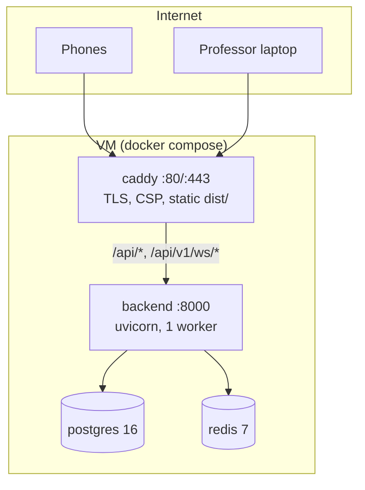
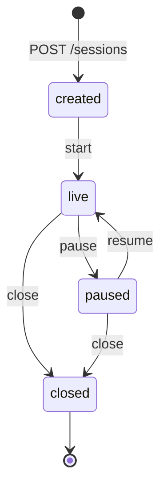
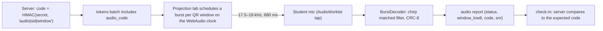
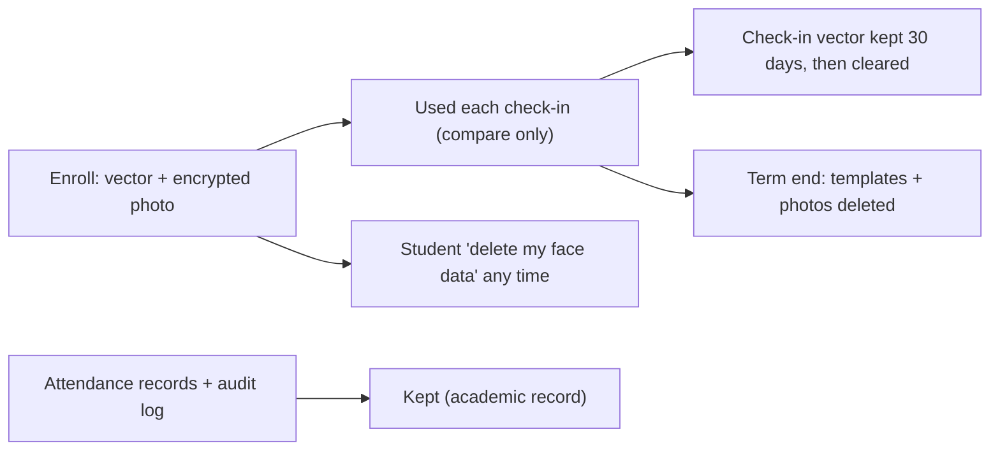

# Architecture internals

Companion to the README. Everything here is derived from the code in `backend/app/`, `shared/` and the two apps; where a number appears it is the constant in `config.py`.

## 1. Process and deployment topology

- Two hostnames, same backend: the student host serves `student-pwa/dist`, the professor host serves `prof-console/dist`; both proxy `/api/*`. Same origin means no CORS.
- One uvicorn worker. Request handlers are sync functions run in the thread pool (SQLAlchemy sessions per request); the WebSocket endpoint is async and shares the in-process hub.
- Redis holds only short-lived state (nonces, rate counters). Losing it on restart is harmless.

## 2. Session state machine

- One open (not closed) session per course (`409 OPEN_SESSION_EXISTS`).
- Check-ins are accepted only while `live`. QR tokens are served only while the session is live.
- `close` writes one `attendance_records` row per rostered student in a single transaction, once.

## 3. Check-in pipeline

Order inside `POST /sessions/{id}/checkin` (`routers/checkin.py`):

1. Rate limit (60/min per student).
2. Load the session; the student must be rostered for its course.
3. **Idempotency:** if this student already has a check-in for the session, return it unchanged.
4. Session must be `live` and the student must have a **confirmed** face template of the current model (`NOT_ENROLLED`, `REENROLL_REQUIRED`).
5. **Hard gate:** parse the QR; wrong session or bad HMAC → `403 TOKEN_INVALID`; right HMAC but outside the accepted windows → `410 TOKEN_EXPIRED`.
6. **Replay guard:** `nonce:{session}:{window}:{student}` claimed with `NX EX 5`; failure → `409 IN_PROGRESS`.
7. **Soft assessment** (`_assess`, nothing here can reject): audio verdict, face distance to the enrolled vector, who else it resembles (`looks_like`, for the professor), liveness from the challenge colours and the colour samples, collision with other check-ins in this session.
8. `trust.score(...)` returns status, score and flags.
9. Insert; the unique `(session_id, student_id)` constraint resolves two simultaneous submissions to the first.
10. Publish `checkin.created` (and `attention.raised` if flagged) to the hub; if a collision was found, mark the other check-in `REVIEW` too and publish `checkin.updated`.

Challenge (`POST /sessions/{id}/challenge`): random sequence of 4 colours from `red, green, blue, yellow, magenta, cyan`, 60 s lifetime, single use, bound to student and session.

### Liveness (colour flash)
The phone shows each colour full-screen while the front camera measures the mean face RGB. For each step, the chroma of `(sample − baseline)` must point toward the chroma of the colour shown (cosine ≥ 0.3); 3 of 4 steps must pass. A face on a photo or a screen that does not respond to the phone's own light fails. This is a casual-cheater defence, not a defence against a purpose-built attack.

### Face comparison
128-d `face-api` descriptors (`faceapi-128-v1`). Euclidean distance to the enrolled vector ≤ 0.55 passes. Two *different* accounts in one session closer than 0.45 are a collision: both go to review. Placeholder or old models are refused at enrollment (`422 BAD_MODEL`) or at check-in (`409 REENROLL_REQUIRED`).

## 4. Audio beacon

Purpose: weak evidence that the phone heard the room, not just the QR.

- Burst layout: 40 ms slow up-chirp preamble, then 32 bits sent as 20 ms up/down chirps (window mod 256, 16-bit HMAC code, CRC-8) = 680 ms. Decoding uses a complex-baseband matched filter and works at any sample rate (44.1 and 48 kHz tested in `bench/audio_sim.ts`). Code lives in `shared/audiocodec.ts`, used by emitter and receiver.
- The code is independent of the QR token, so reading the QR does not reveal the audio code.
- Verdicts: heard and matching → no change; not heard → `AUDIO_UNAVAILABLE` and −0.1; a valid but wrong/stale code → `AUDIO_MISMATCH` (review). It never rejects.
- Only sessions created with `audio_mode=burst` evaluate audio. The phone sends numbers (status, low window bits, code, SNR), never sound.
- Why soft: see `docs/research/ultrasonic-audio-reliability.md`. Browsers and phone DSP vary; the real answer comes from `docs/FIELD_PROTOCOL.md`.

## 5. Live feed

`events.Hub` keeps, per session, a monotonically increasing `seq` and a ring of the last 500 events. A WebSocket client connects to `/ws/sessions/{id}?token=<access>&since_seq=N`:

- Not the owning professor → close code 4401 (not authenticated / wrong role) or 4404 (not your session).
- First frame `hello` carries `resync`: true if `N` is newer than the server knows (restart) or older than the ring; the client then reloads state over REST. Otherwise the missed events are replayed in order, registered atomically with the backlog read so none are lost or doubled.
- `stats.tick` every second (counts, rate, p50/p95 latency); `ping` text keeps the socket alive.
- Publishing is thread-safe (check-in handlers run in the thread pool and use `call_soon_threadsafe`). Multi-worker deployment would need this hub on Redis pub/sub.

## 6. Attention Panel (`attention.py`)

Per live session it ranks students for the professor's eyes:
1. Flagged check-ins (review flags), highest risk first, with the `looks_like` hint.
2. **Overdue**: rostered, not checked in, more than 180 s after the start, ordered by the student's historical absence rate.
3. Two random `VERIFIED` students as an audit sample. Their verdicts measure the real false-accept rate.

Verdicts `seen`, `not_seen`, `unsure` are stored in `spotchecks` and applied to the attendance record (`seen` → present, `not_seen` → absent; `unsure` leaves it). `resolve` and `manual` give the professor explicit control; every action is audited.

## 7. Attendance records and the calculator

- At close: checked in (VERIFIED) → `present/checkin`; unresolved REVIEW → `present` with note `unreviewed: <flags>`; resolved ones follow the professor's decision; nobody → `absent/default`.
- `calculator.compute(attended, conducted, required_pct, planned_total)` uses `fractions.Fraction`, so `ceil`/`floor` boundaries are exact. `conducted` is the number of **closed-session** records of that student, so a student added mid-term is not blamed for earlier classes.
- Disputes: only on `absent` records, one per record. The owning professor accepts (record becomes `present`, source `resolved`) or rejects with a note.

## 8. Security architecture

| Layer | Mechanism |
|---|---|
| Passwords | Argon2; constant-time dummy verify for unknown identifiers |
| Sessions | JWT HS256, `access` 1 h and `refresh` 14 d, type-checked |
| Authorisation | `require_role`; every query scopes to the caller's own course/student; cross-tenant lookups return the same 404 as missing |
| Photos | Fernet at rest; served only through `/students/{id}/photo?exp&sig` HMAC URLs valid 5 minutes for the owning professor; each view audited |
| Transport | HTTPS via Caddy, HSTS, CSP per host, `nosniff`, `no-referrer`, `X-Frame-Options DENY` |
| Abuse | Per-account login lockout, per-user challenge and check-in limits, request size caps on photo (500 KB) and CSV (1 MB / 1000 rows) |
| Output | CSV export prefixes formula-looking cells; error envelope never includes internals |
| Observability | `x-request-id` on every response and error; JSON logs without query strings, bodies or tokens; append-only `audit_log` |
| Config | Production start-up guards (secret, photo key, Redis, Postgres, face mode, rate limiting) |

## 9. Data lifecycle

## 10. Frontends

**Student app.** Vite + React. First paint is the shell (170 KB main bundle). The 1.33 MB face-api chunk and the 6.4 MB model weights load lazily when the student opens the app and are cached; the 947 KB zxing-wasm decoder loads only when `BarcodeDetector` is missing (iOS Safari). `Scan.tsx` runs: challenge → front camera face step with colour flashes → back camera QR loop (decode, de-duplicate for 2.5 s, submit) → result. The audio listener starts at the beginning so a burst has been heard by the time the QR is read.

**Professor app.** `Projection` renders the QR on a canvas from pre-signed payloads (prefetch 60 s ahead, aligned to the server clock using half the round trip), schedules audio bursts on the WebAudio clock, keeps the screen awake, hides its controls after 3 s. `Session` is the live console: REST for state, WebSocket for deltas with `since_seq` reconnect.

## 11. Testing architecture

Pure modules (`tokens`, `trust`, `calculator`, `audiocodec`) are tested without I/O and with fixed vectors. Router tests use FastAPI's `TestClient` on SQLite with their own users and clean-up. Acceptance suites `test_acceptance_p1…p9` are written by an independent tester from `docs/acceptance/P*.md`. `conftest.py` resets rate-limit counters between tests because seeded users reuse ids.
