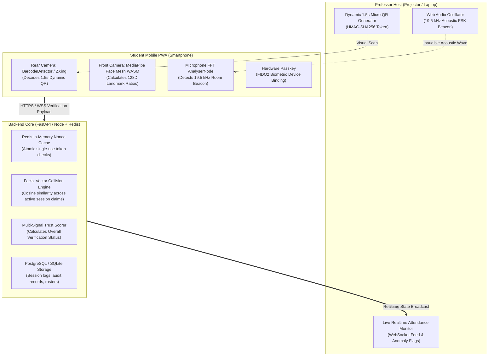
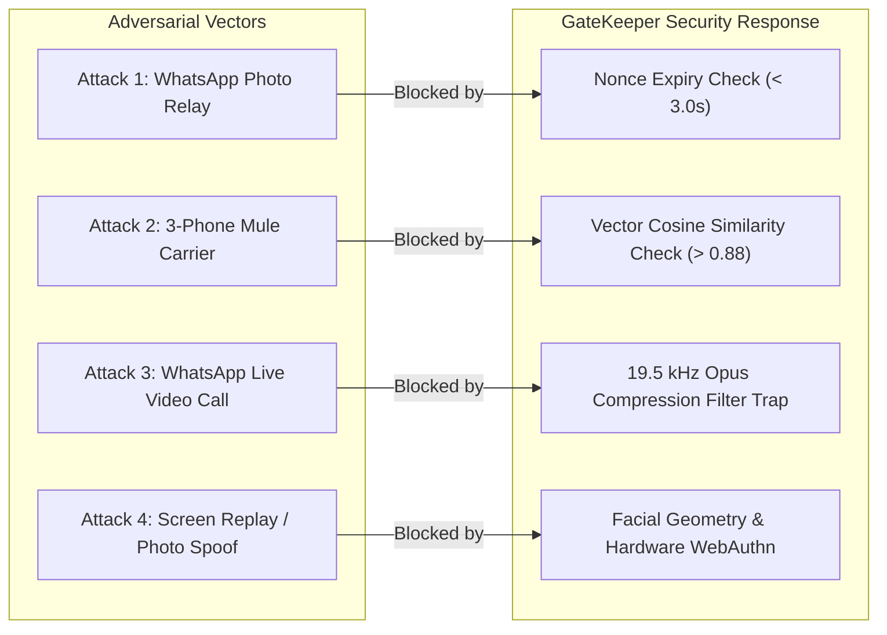

# Product Specification & Benchmarking Test Suite
## Zero-Trust University Attendance Platform (Codename: GateKeeper)

---

## Part 1: Product Description & System Overview

### 1.1 Executive Summary
**GateKeeper** is a lightweight, zero-hardware, zero-trust attendance verification platform tailored specifically for high-capacity university lecture halls (140+ students). 

Current digital attendance systems fail because students effortlessly game them: static QR codes and portal links are forwarded across messaging apps (WhatsApp/Telegram), remote peers scan via live video streams, and physically present students carry multiple phones ("mules") to register absent friends. Traditional hardware countermeasures—such as RFID swipe gates, fingerprint turnstiles, or Bluetooth beacons—are cost-prohibitive, fragile, and create bottleneck queues at classroom entrances.

GateKeeper solves this problem without any proprietary hardware. Using standard web technologies directly in the browser (Progressive Web App), GateKeeper couples three synchronized, lightweight gates:
1. **Cryptographic Micro-QR Windows (1.5s TTL)** to defeat static and forwarded photo relays.
2. **Edge Facial Landmark Collision Detection (WASM MediaPipe)** to defeat the "3-phone mule" attack without storing photos or violating FERPA/GDPR privacy.
3. **Acoustic Room-Containment Verification (19.5 kHz Audio Beacon)** as an ambient trust signal to defeat remote live video calls and adjacent-room snooping.

---

### 1.2 Core Value Proposition

| Stakeholder | Pain Point with Status Quo | GateKeeper Solution |
| :--- | :--- | :--- |
| **Professor** | Spends 10–15 mins manually calling roll; constantly suspects QR forwarding. | Single-click projection; zero roll-call friction; attendance completed in < 60 seconds across 140 students; instant CSV/Excel export. |
| **Student** | Long lines at door scanners; cumbersome biometric hardware; privacy concerns with photo uploads. | Frictionless check-in (< 3 seconds total); no app download required (in-browser PWA); zero photos saved or uploaded. |
| **University IT / Administration** | High CAPEX and maintenance for dedicated biometric kiosks and beacon hardware. | $0 specialized hardware cost; runs on existing classroom projectors, laptops, and student smartphones. |

---

### 1.3 Key Architectural Modules



---

## Part 2: Detailed Feature Mechanics

### 2.1 Feature A: Ephemeral Micro-QR Rotation
* **Interval**: Refreshes every 1,500 ms (1.5 seconds) on an HTML5 canvas.
* **Payload Structure**: `HMAC_SHA256(SessionID + Timestamp_Window + ServerSecret)`.
* **Verification Window**: Accept tokens from $[t - 1, t]$ windows (maximum 3.0s drift allowance for network transit).
* **Ingestion Guard**: Redis atomic operation `SET nonce:token student_id NX EX 5`. If token has already been consumed or is older than 3 seconds, the request is rejected with HTTP 410 (Expired).

### 2.2 Feature B: Edge-Computed Facial Landmark Descriptors
* **Execution**: Executed entirely within the client's WebAssembly sandbox via MediaPipe Face Mesh / TensorFlow.js.
* **Payload**: A normalized vector of 128 floating-point numbers derived from spatial ratios (inter-pupillary distance, nose-to-lip ratio, jawline curvature).
* **Zero-Knowledge Privacy**: No image data, bitmap, or video frames leave the device. Only the numeric descriptor is transmitted over TLS.
* **Mule Collision Engine**:
  $$\text{Cosine Similarity}(V_A, V_B) = \frac{V_A \cdot V_B}{\|V_A\|_2 \|V_B\|_2}$$
  If two distinct student IDs submit vectors where similarity $> 0.88$ within the same lecture session, an anomaly alert (`PROXY_MULE_DETECTED`) is raised for both accounts.

### 2.3 Feature C: Acoustic Room Tokenization (19.5 kHz)
* **Emitter**: Professor laptop speaker uses standard `AudioContext` sine-wave oscillator generating an inaudible carrier frequency between $19.2 \text{ kHz}$ and $19.8 \text{ kHz}$.
* **Receiver**: Student device performs Fast Fourier Transform (`AnalyserNode`, FFT size 2048) on a 1.5-second audio buffer.
* **Signal Classification**:
  * **Pass**: Peak energy in the 19.5 kHz bin exceeds ambient noise floor by $\ge 18\text{ dB}$.
  * **Absence / Codec Drop**: If frequency response cuts off sharply at 16 kHz (hallmark of WhatsApp/FaceTime VoIP Opus compression) or energy is below threshold, flag as `ACOUSTIC_TOKEN_MISSING`.

---

## Part 3: Comprehensive Benchmarking Test Suite

To prove to the professor and university committee that this system is robust, production-ready, and non-trivial, we specify **four rigorous benchmark test suites**.

```
+----------------------------------------------------------------------------------------------------+
|                                    GATEKEEPER BENCHMARK SUITE                                      |
+-------------------+-----------------------------------------+--------------------------------------+
| Category          | Primary Metric Tested                   | Target Threshold                     |
+-------------------+-----------------------------------------+--------------------------------------+
| 1. Throughput     | Peak RPS & Database Ingestion Latency   | 140 check-ins in < 30 seconds        |
| 2. Security       | False Acceptance Rate (FAR) under Fraud | 0% for photo & mule attacks          |
| 3. Client Perf    | PWA Load Time & WASM Inference Latency  | < 200ms inference on mid-tier mobile |
| 4. Hardware Edge  | Audio & Camera Variance across OS/Models| Graceful fallback to Trust Scoring   |
+-------------------+-----------------------------------------+--------------------------------------+
```

---

### Test Suite 1: High-Concurrency Throughput & Load Testing

* **Objective**: Measure system behavior when all 140 students scan the QR code within a compressed 30-second window ("The Thundering Herd").
* **Tooling**: Locust / k6 running headless HTTP/WebSocket concurrent virtual users.

| Test ID | Test Scenario | Concurrency | Success Criteria | Pass / Fail Metric |
| :--- | :--- | :--- | :--- | :--- |
| **TC-PERF-01** | Simultaneous Burst Check-in | 140 virtual users submitting valid payloads in a 15-second window. | Zero dropped connections; 99th percentile response time $< 400\text{ ms}$. | P99 Latency $\le 400\text{ ms}$, Error Rate $= 0\%$. |
| **TC-PERF-02** | Redis Nonce Contention | 140 concurrent requests validating unique rotating tokens against Redis. | Redis memory usage $< 50\text{ MB}$; transaction processing $< 2\text{ ms}$ per token. | Memory $\le 50\text{ MB}$, Avg Check $< 2\text{ ms}$. |
| **TC-PERF-03** | Live Dashboard Broadcast | 1 Professor WebSocket receiving continuous batch state changes. | WebSocket message delivery delay $< 250\text{ ms}$ from submission to UI render. | Broadcast lag $\le 250\text{ ms}$. |

---

### Test Suite 2: Security & Adversarial Attack Simulation

* **Objective**: Formally test the system against the 4 primary cheating vectors.



| Test ID | Adversarial Vector | Attack Execution Protocol | Expected System Response | Result Evaluation |
| :--- | :--- | :--- | :--- | :--- |
| **TC-SEC-01** | WhatsApp Photo Relay | User A snaps QR on projector and sends photo to User B via WhatsApp. User B scans from second phone. | Token expiration validation fails ($t_{\text{elapsed}} > 3.0\text{s}$). Request rejected. | **HTTP 410 Expired**; False Acceptance Rate (FAR) $= 0\%$. |
| **TC-SEC-02** | Physical Mule (3 Phones) | Student X takes 3 distinct enrolled phones to class and scans the projector with each sequentially. | Front camera records Student X's facial landmarks on all 3 submissions. Backend collision detector flags match. | **HTTP 409 Flagged**; Anomaly alert raised on Professor UI. |
| **TC-SEC-03** | Video Call Relay (Hallway) | Student A in class video-calls Student B outside class. Student B scans projector screen displayed over video call. | WhatsApp Opus codec strips 19.5 kHz audio; latency pushes token verification near expiration. | Status downgraded to `FLAGGED_AUDIO_MISSING` / Rejected. |
| **TC-SEC-04** | Photo Spoof of Registered Face | Attacker holds up a printed 2D photo of Student A in front of the camera. | 2D planarity fails micro-liveness depth checks or descriptor variance test. | Request rejected with `LIVENESS_FAILED`. |

---

### Test Suite 3: Client-Side Performance & Resource Usage

* **Objective**: Ensure the student web app runs seamlessly on low-to-mid-end Android and iOS smartphones without battery drain or overheating.
* **Tooling**: Chrome DevTools Performance Profiler, Lighthouse mobile auditing.

| Test ID | Metric | Target Threshold | Critical Failure Threshold |
| :--- | :--- | :--- | :--- |
| **TC-CLI-01** | First Contentful Paint (FCP) on 4G | $\le 1.2 \text{ seconds}$ | $> 2.5 \text{ seconds}$ |
| **TC-CLI-02** | MediaPipe WASM Model Load & Initialization | $\le 800 \text{ ms}$ (cached: $< 150 \text{ ms}$) | $> 2,000 \text{ ms}$ |
| **TC-CLI-03** | Single-Frame Facial Landmark Inference Time | $\le 80 \text{ ms}$ on mid-tier CPU (Snapdragon 7-series / A13 Bionic) | $> 250 \text{ ms}$ |
| **TC-CLI-04** | Camera Viewfinder QR Detection Frame Rate | Stable $\ge 30\text{ FPS}$ (Target $60\text{ FPS}$) | $< 15\text{ FPS}$ |
| **TC-CLI-05** | Memory Footprint (Browser Tab RAM) | $\le 120 \text{ MB}$ during active scan | $> 250 \text{ MB}$ |

---

### Test Suite 4: Real-World Hardware & Environmental Edge Cases

* **Objective**: Measure degradation under imperfect physical classroom conditions.

| Test ID | Environmental Challenge | Real-World Scenario | Mitigation / Fallback Logic |
| :--- | :--- | :--- | :--- |
| **TC-ENV-01** | Projection Glare & Extreme Distance | Student sitting 20 meters away in back row; washed-out classroom projector. | QR version dynamically adjusts to Version 3 (29x29 matrix) with Error Correction Level M; optical zoom hint in PWA viewfinder. |
| **TC-ENV-02** | Classroom Acoustic Noise Floor | 140 students chattering loudly before class ($70\text{--}80\text{ dB}$ ambient noise). | Normal speech rarely contains energy at $19.5\text{ kHz}$; bandpass FFT isolation filters out noise $< 18\text{ kHz}$. |
| **TC-ENV-03** | Microphone Hardware Cutoff on Budget Phones | Budget phone hardware filters out sound above $16\text{ kHz}$. | Audio is implemented as a **Silent Trust Signal**, not a hard blocker. Missing audio marks trust score at 70% instead of 100%, allowing visual teacher confirmation without failure. |
| **TC-ENV-04** | Poor Classroom Lighting | Dimmed lighting during slide presentations. | MediaPipe face detection automatically increases exposure compensation; user prompted to angle device toward ambient projector light. |

---

## Part 4: Implementation & Verification Checklist for the Pitch

When demonstrating this system to professors or evaluation committees, present this three-stage validation proof:

1. **The Live Latency Gauge**:
   Show a real-time monitor displaying the end-to-end transaction latency (target: $< 280\text{ ms}$ from camera capture to database commit).
2. **The Side-by-Side Attack Demo**:
   * *Demo 1*: Send a screenshot of the QR code to a secondary phone. Attempt to scan it on the secondary device and watch the screen flash red with `HTTP 410: TOKEN EXPIRED`.
   * *Demo 2*: Scan two different accounts in front of the same webcam. Watch the Professor Dashboard immediately pop a notification: `Anomaly: Identical Biometric Vector Detected Across 2 IDs`.
3. **The Bandwidth & Privacy Proof**:
   Open browser DevTools Network tab. Show the outgoing payload: only a lightweight JSON string of 128 numbers (size: $1.2\text{ KB}$). Prove that zero images or audio recordings are transmitted.
